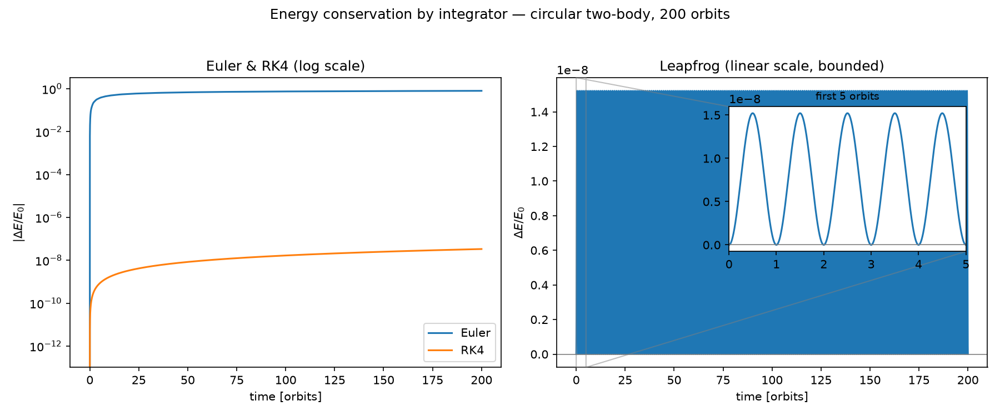
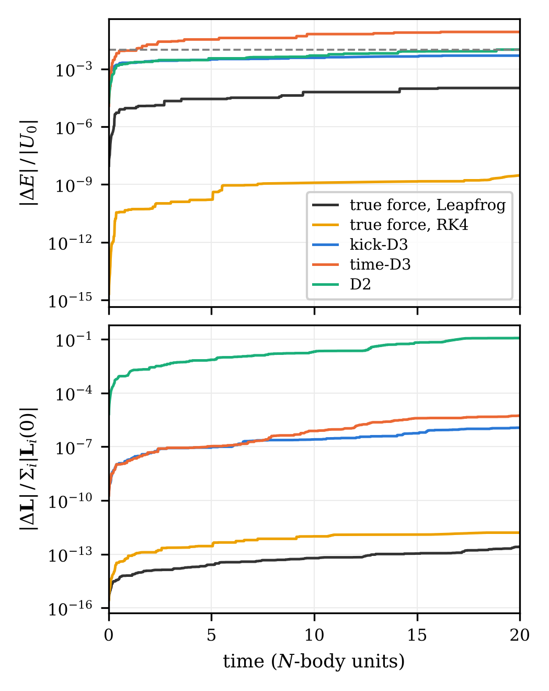
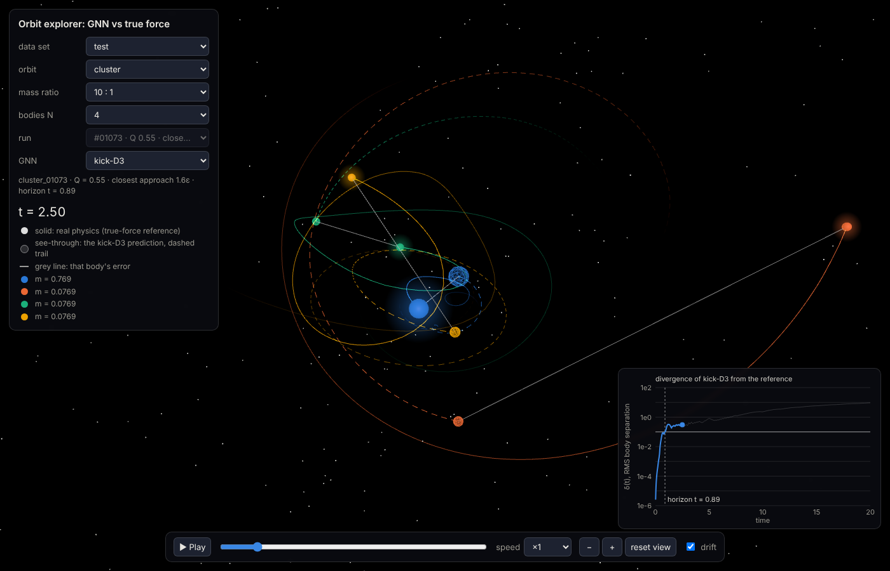

# Can a graph neural network replace a symplectic integrator for small-N gravitational dynamics?

**Answer: no — for 2 to 10 bodies, it cannot.** The reason is the same one that separates classical integrators from each other: over long times, the *structure* of a method's error matters more than its size.

**Full write-up:** [`paper/main.pdf`](paper/main.pdf) (IEEE-style report; LaTeX source in [`paper/`](paper/)).

This project has two parts:

1. **Simulator:** a vectorised N-body simulator in NumPy, used to compare three integrators (Euler, RK4, Leapfrog) and generate a training dataset of 360 trajectories.
2. **GNN surrogate:** a graph neural network, following the approach of DeepMind's Graph Network Simulator (Sanchez-Gonzalez et al., 2020), trained to predict particle accelerations and rolled out through the same Leapfrog loop as the reference.

---

## Part 1: which integrator, and why



| Question | Result |
|---|---|
| Do measured convergence orders match theory (1, 2, 4)? | Yes: Euler ≈ 1, Leapfrog 2.00, RK4 4.37 |
| Does energy error stay bounded or drift? | Leapfrog stays bounded; RK4 drifts slowly (as a slow inward spiral); Euler drifts badly |
| Is angular momentum conserved? | Only Leapfrog conserves it, to round-off level. RK4 and Euler do not |
| Is the more accurate method the better long-term one? | Not always. RK4 has *smaller* energy error per step on eccentric orbits, but its error keeps growing, so Leapfrog's bounded error wins over long runs |

**Outcome:** Leapfrog was chosen to generate the GNN training data, because its error is bounded and unbiased, not because it is smaller.

## Part 2: can the GNN replace it?



| Question | Result |
|---|---|
| Can a GNN learn the force at all? | Only with structure built in. An unconstrained message (D1) fails completely; a central message (D2) learns the force to a median one-step error of 0.6% and recovers the inverse-square law at short range without being told it |
| Can it inherit Leapfrog's conservation laws? | Yes. Central, equal-and-opposite pair messages (D3) conserve momentum and angular momentum to round-off *by construction*, and conserve a learned energy H_L |
| Does that make its trajectories accurate? | No. Its 0.6% force error starts every cluster rollout further from the truth than a 10⁻⁶ perturbation, so trajectories separate from the reference about twice as early (median horizon 1.6–1.7 time units vs 3.4–4.0) |
| What about energy? | Bounded on two-body orbits but offset: about 50× the reference error in clusters and over 1000× on two-body orbits |
| Where you train matters | Weighting the loss towards close encounters gives a *worse* median error but better rollouts; at an extrapolated mass ratio of 15, the quiet-phase-weighted model lasts 1 period, the encounter-weighted one 6 |
| Is it at least faster? | No: 180–280 µs per force call vs 16–27 µs for direct summation (8–14× slower), with the same N² scaling |

The full reasoning, decisions and things that broke are recorded in [`labbook.md`](labbook.md).

---

## Interactive orbit explorer



A single three.js page, [`results/stage_c/orbit_explorer.html`](results/stage_c/orbit_explorer.html), holding all 116 test and holdout runs. Pick any two-body orbit, cluster or figure-eight; rotate it in 3D and play the GNN rollout against the reference. Solid trails are the true-force reference, dashed ones the GNN's prediction, and a grey line joins each body to where the GNN thinks it is — so the moment the rollout breaks away from the truth (the paper's *horizon*) is something you can watch, with the live divergence chart in the corner tracking it. A run can also be linked directly, e.g. `orbit_explorer.html#cluster_01073&t=2.5`.

To view it, download the file and open it in a browser — it carries all the trajectory data itself (~34 MB, so GitHub won't preview it) and fetches only three.js from a CDN. Built by `gnn/orbit_explorer.py`.

---

## Repository structure

| File | Purpose |
|---|---|
| `bodies.py` | System state (masses, positions, velocities) |
| `forces.py` | Vectorised pairwise gravity with softening |
| `integrators.py` | Euler, RK4, Leapfrog behind a shared interface |
| `simulation.py` | Time-stepping loop and HDF5 trajectory output |
| `scenarios.py` | Initial conditions and dataset generation |
| `analysis.py` | Energy / angular momentum drift, convergence-order fits |
| `experiments.py` | Runs the full experiment suite |
| `visualisation.py` | Generates the figures in `figures/` |
| `gnn/` | GNN surrogate: model and message designs (`model.py`), training (`train.py`), rollouts (`rollout.py`, `run_rollouts.py`), evaluation (`evaluate.py`, `g2_slopes.py`–`g5_timing.py`), and the 3D orbit explorer (`orbit_explorer.py`) |
| `results/` | CSV results and figures from the simulator and GNN stages |
| `paper/` | The report: LaTeX source, figures and compiled PDF |
| `paper_figures.py` | Regenerates the simulator figures used in the paper |
| `tests/` | Unit tests (pytest) |
| `labbook.md` | Dated log of every stage |
| `PROJECT_PLAN.md` | Research questions and stage plan |

---

## Running it

```bash
pip install -r requirements.txt
pytest                      # run the tests
python experiments.py       # run the experiment suite
python visualisation.py     # regenerate figures
```

Python 3.12. The `.mp4` animation also needs `ffmpeg` installed. GNN training and evaluation scripts live in `gnn/` and are run as modules, e.g. `python -m gnn.train`.

---

## Possible extensions

- Evaluate the learned energy H_L along rollouts, to separate the force error from the adaptive step's contribution
- Use a time-symmetric adaptive step (Hut, Makino & McMillan 1995)
- Test where a surrogate *should* pay off: a force that is expensive to evaluate, or a model that permits larger steps
