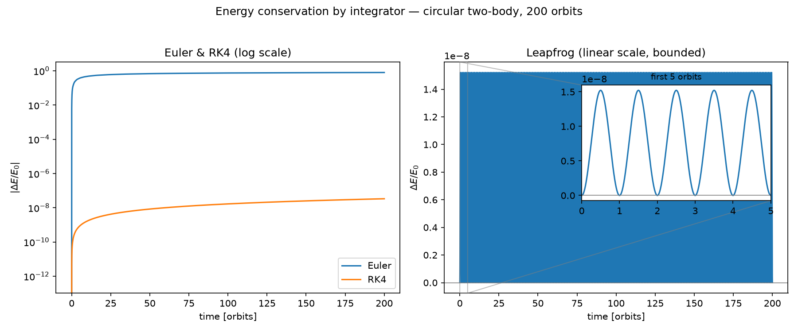

# Gravitational N-Body Simulation and GNN Surrogate

**Can a graph neural network learn to step a gravitational N-body system forward as faithfully as a physics-preserving numerical integrator, and at what computational cost?**

This project has two parts:

1. **Simulator (complete):** a vectorised N-body simulator in NumPy, used to compare three integrators (Euler, RK4, Leapfrog) and generate a training dataset.
2. **GNN surrogate (in progress):** a graph neural network, following the approach of DeepMind's Graph Network Simulator (Sanchez-Gonzalez et al., 2020), trained to predict particle accelerations and roll out trajectories.

**Status:** Simulator stages complete, with results below. GNN stage just started.

---

## Key results so far



| Question | Result |
|---|---|
| Do measured convergence orders match theory (1, 2, 4)? | Yes: Euler ≈ 1, Leapfrog 2.00, RK4 4.37 |
| Does energy error stay bounded or drift? | Leapfrog stays bounded; RK4 drifts slowly; Euler drifts badly |
| Is angular momentum conserved? | Only Leapfrog conserves it, to round-off level. RK4 and Euler do not |
| Is the more accurate method the better long-term one? | Not always. RK4 has *smaller* energy error per step on eccentric orbits, but its error keeps growing, so Leapfrog's bounded error wins over long runs |

**Outcome:** Leapfrog was chosen to generate the GNN training data (360 simulation runs), because its error is bounded and unbiased, not because it is smaller.

The full reasoning, decisions and things that broke are recorded in [`labbook.md`](labbook.md).

---

## Repository structure

| File | Purpose |
|---|---|
| `bodies.py` | System state (masses, positions, velocities) |
| `forces.py` | Vectorised pairwise gravity with softening |
| `integrators.py` | Euler, RK4, Leapfrog behind a shared interface |
| `simulation.py` | Time-stepping loop and HDF5 trajectory output |
| `scenarios.py` | Initial conditions and dataset generation |
| `analysis.py` | Energy / angular momentum drift, convergence-order fits |
| `experiments.py` | Runs the full experiment suite |
| `visualisation.py` | Generates the figures in `figures/` |
| `tests/` | Unit tests (pytest) |
| `labbook.md` | Dated log of every stage |
| `PROJECT_PLAN.md` | Research questions and stage plan |

---

## Running it

```bash
pip install -r requirements.txt
pytest                      # run the tests
python experiments.py       # run the experiment suite
python visualisation.py     # regenerate figures
```

Python 3.12. The `.mp4` animation also needs `ffmpeg` installed.

---

## Next steps

- GNN Stage A: data loading and graph construction (PyTorch Geometric)
- GNN Stage B: train the model to predict per-particle accelerations
- GNN Stage C: compare GNN rollouts with Leapfrog on accuracy, energy conservation, generalisation and speed
